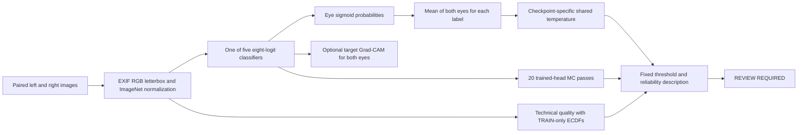

# TrustRetina: final academic research report

**Submission scope: completed reproducible development research through V15. Independent validation is incomplete. All research decisions remain REVIEW REQUIRED.**

Author, institution, supervisor, programme, submission date and institution-specific formatting must be supplied by the submitting student; none is invented here. This report is prepared from public committed aggregate evidence after merged PR #32. It does not access private patient data, rerun training/calibration/inference, or reopen the historical final cohort.

## Abstract

TrustRetina investigates a reproducible paired-eye retinal screening research pipeline using original ODIR-5K patient-derived eight-label targets. It combines immutable provenance, leakage-aware patient/component roles, five fixed image classifiers, shared-temperature calibration, trained-head Monte Carlo Dropout, technical quality signals and class-specific explanations. The initial five-backbone development comparison selected ConvNeXt-Tiny by validation macro AUROC. Later controlled loss/resolution studies and two frozen V14 candidates retained all class-specific false-positive/false-negative tradeoffs. Real V15 CPU analysis fitted one scalar per frozen checkpoint: T=1.105496125613 at320 and T=1.002532561130 at224. Small NLL/Brier decreases coexisted with worse ten-bin ECE in both cohorts/resolutions; quality fusion also worsened Hamming risk-coverage AURC. Binary classification remained unchanged. Calibration diagnostics are in sample and validation was reused; no independent clinical validation, clinical safety, disease-discrimination improvement from calibration, or validated acceptance policy is established. The original local demo remains frozen and separate from later research candidates.

## 1. Research objective and contributions

The question is whether transparent model comparison and post-freeze reliability analysis can characterize retinal multi-label predictions without hiding weak-class errors or leakage/selection limitations. The contribution is an auditable research system and a sequence of bounded experiments, including negative findings, rather than a clinically certified screening product. Separate questions concern backbone choice, training schedule/loss/resolution, probability calibration and descriptive uncertainty/quality ranking. They use different experiments and must not be pooled into a single unbiased leaderboard.

## 2. Architecture and software implementation

The five torchvision factories are EfficientNet-B0, ResNet50, DenseNet121, ConvNeXt-Tiny and EfficientNet-B2. A common trained dropout(p=0.2)/linear head produces eight independent logits; sigmoid/BCE represents multi-label targets. No softmax, argmax or flattened F1 substitutes for the(n,8) task. Verified ImageNet states are loaded strictly from local checksum-bound artifacts; no random-weight fallback can produce a demo research result. Configuration, source, role, checkpoint and dependency identities are recorded. [Implementation](../src/trustretina/models/backbones.py).

Source modules implement data validation/containment, preprocessing, models, training/resume, evaluation, calibration/reliability, Grad-CAM, inference and Streamlit session handling. The historical Phase0 CLI plan remains declarative; its `not_implemented` job inventory is not a statement that later dedicated execution controllers never ran.

## 3. Dataset, target semantics and leakage control

Original ODIR-5K `data.xlsx` is authoritative. Target positions are N,D,G,C,A,H,M,O: normal, diabetes, glaucoma, cataract, age-related macular degeneration, hypertension, pathological myopia and other abnormalities, using source research semantics. A positive patient target is inherited by both eye images; it does not establish that either specific eye has an independently verified diagnosis. H retinal-versus-systemic meaning and O heterogeneity limit transport to other datasets. Missing/unknown external labels must never be made negative.

The development records report3,500 patients/7,000 images checked historically. The accepted v4 TRAIN/validation/calibration roles contain2,275/525/350 patients, with two eyes each. Historical final is separate and has already been used; it is not reopened or repurposed as fresh evidence here. No official-test metric is valid without ground truth. [Data contract](DATA_PIPELINE.md) and [v4 protocol](DEVELOPMENT_V4.md).

Exact raw/decoded image equality and targeted photographic evidence are distinguished from weak perceptual-hash candidates. The initial giant weak-hash grouping and premature readiness were superseded. Later fixed-schedule review and explicit connected-patient containment preserved unresolved material relationships without declaring every link a confirmed duplicate. Both eyes and all connected patients remain together; role separation, both-eye completeness, class support and immutable hashes are checked. Mixed-label components retain their patient vectors without voting/relabeling. Containment reduces known leakage risk but does not prove that all duplicates or unknown leakage have been eliminated.

TRAIN labels determine training loss weights only. Validation selects checkpoints/backbones under each phase's frozen rule. Calibration fits the checkpoint-specific scalar only after model freeze. Neither calibration nor the now-used historical final is a model-selection resource for these later stages. [Protocol precedence](EXPERIMENT_PROTOCOL.md): prospective v4/v5/v14/v15 contracts supersede early planning defaults; early suggested augmentation/selection/per-class-temperature plans are not descriptions of every executed stage.

## 4. Preprocessing and model training

Shared preprocessing applies EXIF orientation, RGB conversion, aspect-preserving bilinear letterbox to224 or native320, ImageNet-mean padding and ImageNet channel normalization. The executed v5/v14 protocols use no augmentation. Native320 inputs are not an upscaled224 cache. Raw inputs and frozen partitions are immutable. Geometry/padding and preprocessing fingerprints are recorded. [Code](../src/trustretina/preprocessing/shared.py).

In v5 all five backbones started from verified ImageNet V1, not the random pilot. Common settings were seed2026, FP32 AdamW, learning rate1e-4, weight decay0.01, batch16, TRAIN-patient negative/positive ratio BCE weights, maximum10 epochs, no scheduler and patience3/minimum meaningful loss improvement1e-4. Checkpoints minimize validation patient weighted BCE, earliest exact tie; backbone choice uses validation macro AUROC across all eight defined classes. [Executed protocol](FULL_EXPERIMENT_V5.md).

Later v14 fits used ratio BCE, seed2026, FP32 AdamW, learning rate1e-4 to1e-6 cosine over a25-epoch horizon, microbatch8/accumulation2 (effective16), and no augmentation. Validation patient macro AUROC selects the checkpoint; patience6/min_delta1e-4 governs stopping. Both completed11 epochs with best epoch5. They are distinct from v5 and are not a controlled estimate of resolution alone against the original demo. Source/nonce/report/hash checks, strict best reload, state invariance and post-freeze saved calibration outputs bind provenance. [Frozen v14 protocol](CANDIDATE_FREEZE_V14.md).

Best/last checkpoints and epoch-boundary optimizer/scheduler/RNG/loader states support compatible resume; device/library/source drift and ambiguous submissions block it. Synthetic resume tests are software evidence, not proof of equivalence across arbitrary hardware. No training or GPU job was run to prepare this submission.

## 5. Five-backbone comparison

Recorded v5 validation patient metrics at fixed p>=0.5; no scientific values were recomputed for this report:

| Backbone | Epochs/best | Macro AUROC | Macro AP | Macro F1 | Micro F1 |
|---|---|---|---|---|---|
| efficientnet_b0 | 5 / 2 | 0.7876 | 0.4686 | 0.4055 | 0.4230 |
| resnet50 | 5 / 2 | 0.7784 | 0.4632 | 0.3708 | 0.3974 |
| densenet121 | 6 / 3 | 0.8119 | 0.5053 | 0.4607 | 0.4773 |
| convnext_tiny | 5 / 2 | 0.8288 | 0.5398 | 0.4762 | 0.4988 |
| efficientnet_b2 | 5 / 2 | 0.8048 | 0.4933 | 0.4280 | 0.4697 |

ConvNeXt-Tiny was selected for subsequent original research calibration. These are selection-cohort development estimates, not external validation. Model size/timing also differ; warmed GPU timings from the original workers are not newly measured Mac/CPU latency. Full per-class supports and metrics remain in the [published v5 comparison](../results/full-v5/README.md).

## 6. Original calibration, explanations and historical evaluation

Phase6 fitted the original ConvNeXt epoch2 shared T=0.722602 on350 calibration patients after mean-eye sigmoid aggregation. It implemented20 trained-head MC passes, TRAIN-only technical quality ECDFs, fixed reliability ablations and Grad-CAM. Its calibration diagnostics are in sample; the original validation cohort already selected the backbone. The quality factor had negative risk-coverage findings. No clinically supported automatic acceptance cutoff was fitted. [Original results](../results/reliability-v6/README.md).

Public status/protocol records describe the once-run Phase7 frozen evaluation as complete. This submission neither opens private holdout images/labels/predictions nor executes that pipeline, and does not select new parameters from historical results. Existing public app evidence is historical context. No old held-out result may be attributed to the newer V14/V15 candidates. Repartitioning the same data is not fresh independent confirmation. [Historical protocol](FINAL_EVALUATION_V7.md) and [previously published aggregate report](../results/final-v7/REPORT.md); no cohort access or replay is needed to reference this historical evidence.

Grad-CAM differentiates a selected raw patient target with respect to spatial features and shows a separate map for each eye on the canonical input canvas. The selected explanation target is distinct from the full predicted-positive label list. Zero maps and unsupported cases are handled explicitly. A heatmap is not lesion ground truth, clinical localization validation, or evidence that a probability is correct.

## 7. Subsequent development experiments and audit

- **V9:** four completed fixed schedule/backbone runs on reused validation; the ConvNeXt cosine run reported macro AUROC 0.84173 and macro F1 0.59263. Comparing it with v5 also changes selection/budget; the within-v9 schedule contrast is cleaner. [Results](../results/round2-v9/RESULTS.md).
- **V10:** group-aware threshold CV reported macro F1 0.5926→0.6055 while FP243→425 and FN276→186; H remained TP3/FP1/FN13. It separates threshold fitting only, not prior model selection. Those fold thresholds were never deployed. [Results](../results/threshold-v10/RESULTS.md).
- **V11:** six training-only nested loss fits reported mean macro AUROC 0.83451 (ratio) versus0.83549 (square-root), but mean macro F1 0.53901 versus0.51359. Conditional AUROC evidence did not establish square-root superiority; fewer FP accompanied more FN. [Discussion](../results/nested-v11/DISCUSSION.md).
- **V12:** the bounded saved-evidence audit retained ratio BCE, examined H/O and preprocessing/quality hypotheses, and did not clinically relabel patients. Sparse support, label granularity and detail loss are hypotheses rather than established sole causes. [Audit](../results/development-audit-v12/REPORT.md).
- **V13:** six matched224/320 fits used training-only containment folds with inner-only checkpoint selection. Mean outer macro AUROC 0.83273→0.85108, AP 0.57279→0.59412 and macro F1 0.53758→0.57156 favored320 on this development study, with H/O false-positive and H-F1 harms retained. The conditional paired macro-AUROC interval was[+0.01036,+0.02655]; this is not independent confirmation. [Discussion](../results/resolution-v13/DISCUSSION.md).

These studies have different fitting sizes, estimands and development exposure. Their numbers cannot be interpreted as a single unbiased longitudinal performance improvement, averaged across unrelated cohorts, or substituted for independent evidence.

## 8. Frozen V14 candidates

Recorded reused-validation results, separate from v5/demo:

| px | Epochs/best | Macro AUROC | Macro AP | Macro F1 | Micro F1 |
|---|---|---|---|---|---|
| 320 | 11 / 5 | 0.8596 | 0.5993 | 0.5371 | 0.5532 |
| 224 | 11 / 5 | 0.8480 | 0.5812 | 0.5332 | 0.5290 |

The 320 result is not uniformly better: validation C FP99/FN1/F1 0.3827 versus224 FP30/FN4/F1 0.6222; A recall0.44 versus0.72; G recall0.50 versus0.5625; H FP6/FN12 versus21/11; O FP119/FN53 versus118/61. Sparse H has16 validation positives. All eight class rows are retained in the [V14 report](../results/candidate-v14/RESULTS.md). No new significance interval or independent winner is invented.

## 9. Verified real V15 calibration and reliability

The original V4 role manifests were reconstructed privately with exact frozen SHA256 matches. All36 V14 artifacts, original/derived patient-eye-role-component-class alignment, separate quality/prediction ordering and saved20-pass MC seed identities passed the recorded verification. Publication in merged PR32 released only reviewed aggregate tables/figures; this submission consumes those public values, not private research files.

One shared scalar per checkpoint minimizes component-equal mean eight-label patient NLL with inverse component-size weights, bounded log-T optimization T∈[0.05,20], xatol1e-8/maxiter500 and a feasible identity reference. At least50 components and both outcomes per class are numerical refusal floors, not rare-class power guarantees. Calibration uses350 patients/331 components; descriptive reused-validation uses525/518. The transform is `sigmoid(logit(clip(mean_eye_sigmoid,1e-6,1-1e-6))/T)`; it also transforms each saved patient MC pass. Both optimizers succeeded without hitting a boundary.

| Candidate | Shared T | Optimizer evaluations |
|---|---|---|
| v14_candidate_res320_seed2026 | 1.105496125613 | 12 |
| v14_reference_res224_seed2026 | 1.002532561130 | 16 |

Raw → calibrated metrics (patient weighting for NLL/Brier; mean eight-class ten-bin ECE):

| Cohort | px | NLL | Brier | Macro ECE |
|---|---|---|---|---|
| calibration | 320 | 0.346562 → 0.344890 | 0.110584 → 0.110352 | 0.106996 → 0.109262 |
| validation | 320 | 0.338582 → 0.337590 | 0.107454 → 0.107377 | 0.102910 → 0.105733 |
| calibration | 224 | 0.326825 → 0.326823 | 0.105355 → 0.105350 | 0.108006 → 0.108073 |
| validation | 224 | 0.334581 → 0.334556 | 0.107695 → 0.107687 | 0.105690 → 0.105761 |

**Negative reliability finding:** NLL/Brier decreased slightly but ECE increased in all four cohort/resolution combinations. A component-equal NLL objective does not optimize ECE or every class. The224 temperature is almost identity. On reused validation,224 has lower calibrated NLL while320 has slightly lower Brier and almost identical ECE. There is no uniform reliability advantage. Positive shared-temperature mapping preserved all p>=0.5 binary decisions, precision/recall/F1 and confusion counts. It cannot repair class discrimination errors or establish improved disease detection.

All per-class NLL/Brier/ECE, supports, confusion counts, FPR/FNR and reviewed diagrams are in the [V15 report](../results/calibration-v15/RESULTS.md). In both models N/D validation ECE decreased, while G/C/A/H/M/O ECE increased. Calibration A/H/M have16/10/17 positive patients; validation H has16. A scalar global result is not a class-conditional calibration guarantee. The original prospective protocol, all frozen models/thresholds and old demo calibration remain unchanged.

## 10. Uncertainty, quality and descriptive risk coverage

Confidence is minimum class max(p,1−p). Head-only MC uncertainty is maximum class population variance over20 saved patient-probability passes; normalization and backbone stochastic depth stay in eval. It is not full model/epistemic uncertainty. Separate224/320 TRAIN feature ECDFs use foreground fraction, contrast and gradient energy, average ranks per eye, and the lower eye score per patient. They are technical proxies, not clinical gradability.

The fixed scores are confidence, confidence×clip(1−4u,0,1), and that score×q. V15 remapping reduced mean saved variance and increased predictive entropy; it does not prove reduced epistemic uncertainty. Adding uncertainty changed ranking slightly. Adding quality worsened Hamming AURC in both cohorts/resolutions/modes, consistent with earlier negative quality findings. Calibrated validation confidence/+uncertainty/+quality AURC was0.126622/0.126251/0.140051 at320 and0.124517/0.124365/0.139728 at224. No strategy is selected or deployed.

Risk-coverage curves include whole tied-score blocks and are retrospective prefixes, not actual ACCEPT decisions. Hamming risk can conceal positive-class misses. The200 paired whole-component bootstrap replicates, seed2026, preserve multiplicity and identical model draws. All320−224 AURC intervals include zero; they condition on fitted candidates and are not selection-adjusted or independent clinical guarantees. Saved patient MC arrays cannot independently re-prove unavailable per-eye stochastic ancestry.

## 11. Evaluation definitions and evidence hierarchy

Macro F1 averages eight binary class F1 values; micro F1 pools TP/FP/FN on equal-shaped(n,8) arrays. AUROC/AP require both outcomes; AP means average precision, not an arbitrary trapezoidal PR area. Report precision, recall, F1, TP/FP/FN/TN, FPR/FNR and supports per class. Subset exact match requires all eight decisions correct; labelwise binary accuracy is accuracy over label bits, not diagnostic accuracy. Undefined denominators/outcomes require explicit flags. ECE averages ten-bin class gaps and is sensitive to binning/support; it should not be substituted for patient NLL or Brier.

Evidence levels are kept separate: synthetic tests establish software contracts; original worker reports describe completed historical execution; saved aggregate metrics describe their particular development cohorts; independent clinical confirmation requires new eligible evidence. Bootstrap intervals do not erase prior selection or single-seed training variability. No per-class superiority, clinical recall target or acceptance risk bound is introduced.

## 12. Streamlit application and reproduction

The original demo uses the **v5 ConvNeXt-Tiny epoch2 / Phase6 T≈0.722602**, its verified normalizer and fixed0.5 rule. It does not silently use the V14 epoch5 models or either V15 temperature. Paired uploads, safe image decoding/size limits, eight probabilities, experimental confidence/variance/quality, separate target Grad-CAM, result export and session reset are implemented. Missing/corrupt bundles fail closed; no random weights produce a result. The result/evidence page displays historical public aggregates, not a new independent evaluation.

Current submission checks use generated PNGs and a fake service to exercise input gating, result presentation, explanation target selection and reset. They do not load private weights or demonstrate real model accuracy, numerical parity or native Mac execution. Historical Linux demo checks and portable launcher evidence remain distinguishable from this synthetic review. [Submission setup/checklist](FINAL_SUBMISSION_CHECKLIST.md) and [Mac quickstart](MACOS_QUICKSTART.md).

Use Python3.11/3.12, pinned Linux CPU/report/app locks, package consistency checks and the test suite. App runtime is credential-free once a separately authorized exact private inference bundle is installed. Bundle recovery, patient images and real inference are excluded from this submission task. macOS13+/nativeARM64 Python3.11/3.12 is a supported packaging target; native Finder/Gatekeeper, installation and numerical/runtime behavior remain unverified here. A local loopback address is not a Cloud-to-laptop preview route. Credentials, datasets and private checkpoints must never enter submission assets.

## 13. Audit of completed phases through V15

Phase/version labels below follow executed project history; the original five-stage roadmap is historical planning, not the numbering of every later research version.

| Phase/version | Stage | Audit status | Evidence and boundary |
|---|---|---|---|
| 0 | Foundation | Complete | Package, configuration, declarative planning and capability checks. [Source](PHASE0_REVIEW.md) |
| 1 | Data validation and initial splits | Complete; early split acceptance superseded | Workbook/image checks implemented; later review revised the experimental release. [Source](DATA_PIPELINE.md) |
| 2 | CPU research modules | Complete | Five factories, preprocessing, evaluation, checkpoint and authorization contracts. [Source](PHASE2_CPU.md) |
| 3 | Bounded duplicate review | Completed through later v4 resolution | Initial partial review correctly blocked execution; historical weak-hash grouping was not accepted as truth. [Source](DUPLICATE_REVIEW_V2.md) |
| 4 | Contained release and execution pilot | Complete | Fixed scheduled review and explicit containment; one bounded random-initialization pilot, not performance evidence. [Source](DEVELOPMENT_V4.md) |
| 5 | Five-backbone comparison | Complete | All five ImageNet-initialized development fits and aggregate comparisons. [Source](../results/full-v5/README.md) |
| 6 | Original reliability/calibration/explanations | Complete; clinical policy unsupported | One original shared temperature, head-only MC, technical quality and Grad-CAM; REVIEW REQUIRED. [Source](../results/reliability-v6/README.md) |
| 7 | Historical frozen evaluation | Recorded complete; not reopened | Status records a once-run frozen evaluation; no holdout records or replay used for this submission. [Source](FINAL_EVALUATION_V7.md) |
| 8 | Streamlit research demo and Mac launcher | Implemented; native Mac verification outstanding | Original frozen candidate only; local CPU/synthetic UI and portable launcher checks. [Source](DEMO_V8.md) |
| 9 | Controlled development runs | Complete | Four fixed schedule/backbone runs; reused-validation interpretation. [Source](../results/round2-v9/RESULTS.md) |
| 10 | Exploratory threshold CV | Complete; thresholds not deployed | Group-aware threshold assessment does not undo prior checkpoint-selection exposure. [Source](../results/threshold-v10/RESULTS.md) |
| 11 | Nested training-only loss comparison | Complete | Six paired fits; square-root weighting did not establish superiority. [Source](../results/nested-v11/DISCUSSION.md) |
| 12 | CPU development audit | Complete | Saved evidence reviewed; hypotheses about H/O/quality are not proven causes or clinical relabeling. [Source](../results/development-audit-v12/REPORT.md) |
| 13 | Matched-resolution study | Complete; independent confirmation absent | Six fits; conditional development evidence nominated320 with class-specific harms retained. [Source](../results/resolution-v13/DISCUSSION.md) |
| 14 | Two full-role frozen candidates | Complete | Matched320/224 fits, strict reload and saved post-freeze outputs; original demo preserved. [Source](../results/candidate-v14/RESULTS.md) |
| 15 | Real CPU calibration and reliability | Complete; development only | Two scalar temperatures and all prespecified reliability ablations; negative ECE/quality findings published in merged PR32. [Source](../results/calibration-v15/RESULTS.md) |

## 14. Limitations, ethics and future work

Independent validation is incomplete. There is no verified untouched paired-eye cohort with compatible authoritative ground truth for all eight ODIR targets. BRSET credentialing/CITI/DUA, actual eligibility and label compatibility remain unresolved; missing labels stay unknown. A prospective site/temporal cohort needs lawful access, native label definitions including H/O/N, patient/exam/laterality handling, overlap exclusion, adequate positive/negative independent-component support, precision/power planning and a fixed endpoint before outcome analysis. The used historical final cohort cannot be recycled as fresh confirmation. Any new evaluation/inference requires separate approval.

Patient-level source targets, eye-label inheritance, class imbalance/co-occurrence, sparse H support, mixed containment components, uncertain residual leakage, repeated development exposure, one-seed dependence and conditional uncertainty all limit generalization. Resolution, image quality, sample size, annotation ambiguity and aggregation may contribute to errors but are not proven sole causes. Clinical diagnosis, validated quality grading, localization validation, clinical risk thresholds and automatic acceptance remain unsupported.

Private artifact preservation is still a governance dependency: no verified durable encrypted backup/restore drill or second durable copy is established. The source snapshot/workspace is not durable archival evidence. Backup actions remain separately authorized and were stopped, not resumed for this submission. Public hashes cannot independently authenticate unavailable patient-level evidence; author-controlled retention and review are necessary.

## 15. Submission readiness and conclusion

The development project has a completed implementation, recorded multi-stage experiments through V15, negative findings, public provenance, a frozen research demo, reproducible CPU software checks and a final report/presentation outline. It is suitable for academic review **as development research**, subject to institutional formatting, author/supervisor details, citation review and sign-off. It is not an independently validated clinical screening system. Final merge/release and any private artifact distribution require their own approval. The final checklist records observed checks and explicit remaining gaps; none is hidden by the word complete.

The central conclusion is that aggregate ranking/calibration gains do not guarantee class-level error or reliability improvement. TrustRetina preserves that distinction: later320 results retain serious C/A/G/H tradeoffs, scalar fitting slightly lowers losses while worsening ECE, and technical quality fusion worsens descriptive risk coverage. Every decision remains **REVIEW REQUIRED**.

## References and reproducibility sources

For the examiner-facing question/evidence map, design decisions, ablation trail,
failure hypotheses, contribution disclosure, reproducibility levels and viva,
see [Research evidence and critical analysis](ACADEMIC_RESEARCH_DEFENCE.md).
The [all-eight-class comparison](ALL_EIGHT_CLASS_COMPARISON.md) consolidates the
recorded V14/V15 reused-validation class errors and raw/calibrated ECE. These are
presentations of existing public evidence, not additional scientific computation.

Primary project evidence: [five-model comparison](../results/full-v5/comparison.json), [original reliability](../results/reliability-v6/README.md), [v9](../results/round2-v9/RESULTS.md), [v10](../results/threshold-v10/RESULTS.md), [v11](../results/nested-v11/DISCUSSION.md), [v12](../results/development-audit-v12/REPORT.md), [v13](../results/resolution-v13/DISCUSSION.md), [v14](../results/candidate-v14/RESULTS.md), [V15 public aggregates](../results/calibration-v15/aggregate-results.json). [Source digest index](../results/submission-audit/source-provenance.json) binds the public records used; no private evidence is read or republished by this submission.

Method background (not external performance comparators):

1. ODIR2019 organizers, [Ocular Disease Intelligent Recognition challenge](https://odir2019.grand-challenge.org/), original dataset/task context. Source patient labels and actual access/license conditions remain authoritative.
2. He et al., *Deep Residual Learning for Image Recognition*, [arXiv:1512.03385](https://arxiv.org/abs/1512.03385).
3. Huang et al., *Densely Connected Convolutional Networks*, [arXiv:1608.06993](https://arxiv.org/abs/1608.06993).
4. Tan and Le, *EfficientNet: Rethinking Model Scaling for Convolutional Neural Networks*, [arXiv:1905.11946](https://arxiv.org/abs/1905.11946).
5. Liu et al., *A ConvNet for the 2020s*, [arXiv:2201.03545](https://arxiv.org/abs/2201.03545).
6. Guo et al., *On Calibration of Modern Neural Networks*, [arXiv:1706.04599](https://arxiv.org/abs/1706.04599). Project-specific component weighting/mean-eye aggregation follows the committed protocol.
7. Gal and Ghahramani, *Dropout as a Bayesian Approximation: Representing Model Uncertainty in Deep Learning*, [arXiv:1506.02142](https://arxiv.org/abs/1506.02142). The implemented trained-head-only signal has narrower scope.
8. Selvaraju et al., *Grad-CAM: Visual Explanations from Deep Networks via Gradient-based Localization*, [arXiv:1610.02391](https://arxiv.org/abs/1610.02391).
