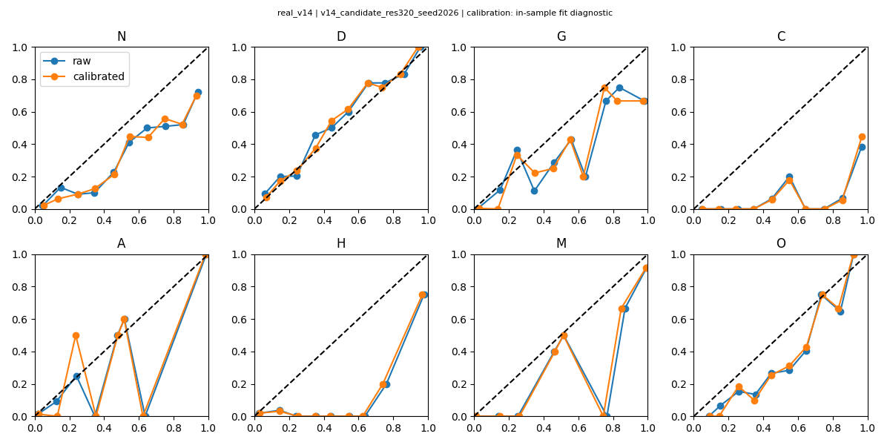
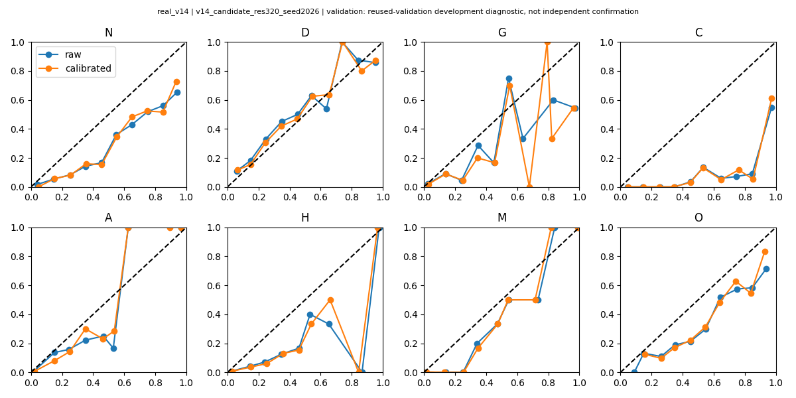
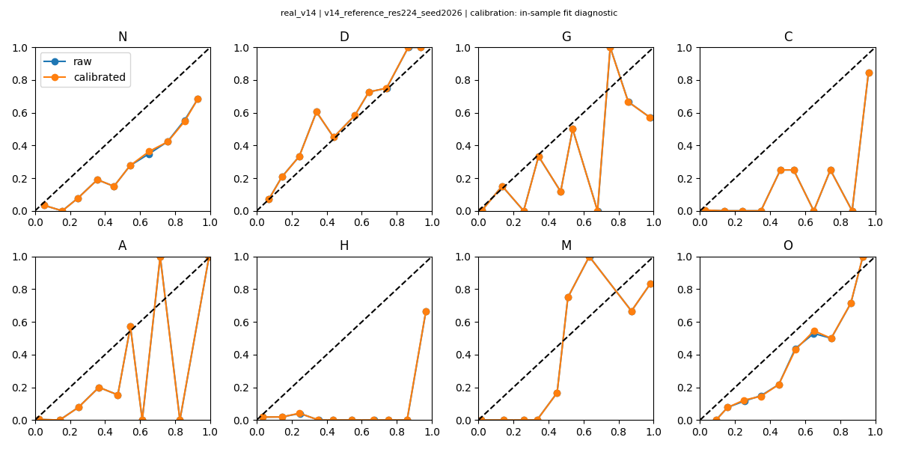
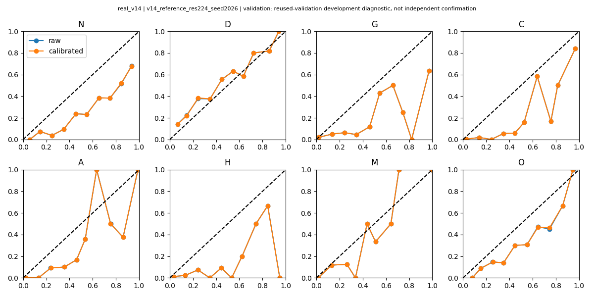

# V15 real CPU calibration and reliability results

**Completed real-data analysis; development only. Independent validation is incomplete. All research decisions remain REVIEW REQUIRED.**

This report publishes recorded aggregate findings from the separately authorized real V15 CPU analysis after merged PR #31. It does not rerun fitting, inference, training or historical final evaluation. The prospective [V15 protocol](../../docs/CALIBRATION_RELIABILITY_V15.md), [V14 freeze](../../docs/CANDIDATE_FREEZE_V14.md) and scientific code remain unchanged. Their implementation-time authorization/readiness statements are historical; current execution status is recorded here and in [STATUS](../../docs/STATUS.md).

## Objective, cohorts and method

Assess the calibration and descriptive reliability of both frozen V14 ConvNeXt-Tiny candidates, using their saved post-freeze probabilities, trained-head MC Dropout arrays and technical quality features. Calibration is not a new test of disease discrimination or clinical safety. No model/strategy is selected from these results.

| Role | Patients | Containment components | Interpretation |
|---|---:|---:|---|
| TRAIN quality reference | 2,275 | Not used as an outcome-analysis cohort | Separate resolution-specific technical feature ECDFs; derived TRAIN rows omit labels |
| Calibration | 350 | 331 | Same cohort used to fit and describe each temperature; in sample |
| Validation | 525 | 518 | Previously reused for model/checkpoint selection; descriptive development only |

Original ODIR patient-derived targets retain class order **N,D,G,C,A,H,M,O**. Each patient has both eyes; patients/components are disjoint across roles. All three original V4 manifest hashes, all 36 V14 object hashes, completed-stage provenance, original/derived row identity, separate prediction/quality order, class order and both-eye completeness passed verification. Saved MC has 20 finite patient-probability passes with validation seeds 62026–62045 and calibration seeds 72026–72045. No historical-final records were accessed.

Exactly one shared scalar T per checkpoint minimizes component-equal mean eight-label patient NLL: each patient receives inverse component-size weight, normalized by the weight sum. The existing bounded log-T optimizer uses T in [0.05,20], xatol=1e-8 and maxiter=500, with a feasible identity reference, at least 50 calibration components and both outcomes in every class. These support floors are numerical safeguards, not evidence of adequate rare-class power.

Patient probability is the mean of the two saved eye sigmoid probabilities. Calibration applies `sigmoid(logit(clip(mean_eye_sigmoid,1e-6,1-1e-6))/T)` after that aggregation, and applies the corresponding T to each saved patient MC pass. There is no mean-eye-logit substitution, class-specific temperature, threshold/policy fitting, old-demo temperature reuse or model refit.

## Frozen identities and fitted temperatures

| Resolution | Run ID | Pinned output version | Shared T | Optimizer evaluations |
|---|---|---|---|---|
| 320 | `v14_candidate_res320_seed2026` | `saisathwikregula/trustretina-v14-fit-320-7bbe5ade/1` | 1.105496125613 | 12 |
| 224 | `v14_reference_res224_seed2026` | `saisathwikregula/trustretina-v14-fit-224-779a38cd/1` | 1.002532561130 | 16 |

Both optimizers succeeded and neither reached a bound. Best-checkpoint SHA256 identities:

- 320 px: `8a3341f2b416355d87a07196e5bc7825a81aa94b30d32e90cf0e65e6134c9bbd`.
- 224 px: `32a316e6c1a898a85249c4ef26df7440bb95d91c6667aecb508b722e17a43695`.

These reported scalars are research results, not replacements for any deployed/frozen demo parameter.

## Raw versus calibrated cohort metrics

Each cell is **raw → calibrated**. Patient NLL weights patients equally; Brier is the mean binary Brier across the eight labels. ECE is the mean of eight class ECEs, using ten equal-width bins, with the rightmost bin including 1 and empty bins contributing zero. Component-equal NLL/Brier are separately disclosed. Lower is better for these losses/discrepancies.

| Cohort | px | Patient NLL | Component-equal NLL | Brier | Component-equal Brier | Macro ECE |
|---|---|---|---|---|---|---|
| calibration | 320 | 0.346562 → 0.344890 | 0.342549 → 0.341347 | 0.110584 → 0.110352 | 0.109569 → 0.109388 | 0.106996 → 0.109262 |
| validation | 320 | 0.338582 → 0.337590 | 0.338315 → 0.337370 | 0.107454 → 0.107377 | 0.107414 → 0.107343 | 0.102910 → 0.105733 |
| calibration | 224 | 0.326825 → 0.326823 | 0.325243 → 0.325242 | 0.105355 → 0.105350 | 0.104712 → 0.104708 | 0.108006 → 0.108073 |
| validation | 224 | 0.334581 → 0.334556 | 0.334552 → 0.334527 | 0.107695 → 0.107687 | 0.107706 → 0.107697 | 0.105690 → 0.105761 |

**Negative reliability finding:** ECE increased in both cohorts at both resolutions despite small NLL/Brier decreases. The 224 px temperature is close to identity; six-decimal rounding hides part of its very small component-NLL change. Full recorded precision is in [the curated aggregate data](aggregate-results.json). NLL optimization does not imply improved ECE or class calibration. After calibration, 224 px has lower reused-validation NLL, while 320 px has slightly lower Brier and nearly identical ECE. There is no uniform resolution advantage.

## Per-class reliability and unchanged classification

All per-class values below are recorded, not recomputed for publication. Calibration is in sample and validation is reused. Binary decisions at p≥0.5 were unchanged for both checkpoints; precision, recall, F1, FP/FN and all confusion counts therefore stayed exactly unchanged.

### Calibration: per-class losses and reliability

NLL / Brier / ECE are raw → calibrated. Support counts apply to both candidates.

| px | Class | Positive | Negative | NLL | Brier | ECE |
|---|---|---|---|---|---|---|
| 320 | N | 116 | 234 | 0.630721 → 0.618899 | 0.216132 → 0.213422 | 0.186615 → 0.183831 |
| 320 | D | 113 | 237 | 0.486604 → 0.484157 | 0.157620 → 0.157254 | 0.051905 → 0.028981 |
| 320 | G | 21 | 329 | 0.140814 → 0.145638 | 0.041485 → 0.041751 | 0.042736 → 0.050576 |
| 320 | C | 21 | 329 | 0.578496 → 0.561778 | 0.180171 → 0.178330 | 0.285797 → 0.292126 |
| 320 | A | 16 | 334 | 0.100051 → 0.103775 | 0.025468 → 0.025876 | 0.016613 → 0.030061 |
| 320 | H | 10 | 340 | 0.183026 → 0.186436 | 0.044281 → 0.045593 | 0.068393 → 0.078308 |
| 320 | M | 17 | 333 | 0.057572 → 0.061128 | 0.014592 → 0.014939 | 0.023468 → 0.027957 |
| 320 | O | 98 | 252 | 0.595212 → 0.597310 | 0.204924 → 0.205651 | 0.180440 → 0.182259 |
| 224 | N | 116 | 234 | 0.699342 → 0.698836 | 0.243107 → 0.242984 | 0.248116 → 0.247974 |
| 224 | D | 113 | 237 | 0.522751 → 0.522572 | 0.172592 → 0.172545 | 0.071203 → 0.070847 |
| 224 | G | 21 | 329 | 0.168986 → 0.169032 | 0.048284 → 0.048291 | 0.053315 → 0.053404 |
| 224 | C | 21 | 329 | 0.227838 → 0.227953 | 0.070793 → 0.070805 | 0.122647 → 0.122849 |
| 224 | A | 16 | 334 | 0.106217 → 0.106399 | 0.027609 → 0.027634 | 0.049448 → 0.049658 |
| 224 | H | 10 | 340 | 0.230758 → 0.230879 | 0.062072 → 0.062107 | 0.113376 → 0.113659 |
| 224 | M | 17 | 333 | 0.070897 → 0.071011 | 0.017289 → 0.017304 | 0.039525 → 0.039667 |
| 224 | O | 98 | 252 | 0.587814 → 0.587902 | 0.201094 → 0.201128 | 0.166420 → 0.166531 |

### Calibration: fixed-threshold classification

| px | Class | TP | FP | FN | TN | Precision | Recall | F1 | FPR | FNR |
|---|---|---|---|---|---|---|---|---|---|---|
| 320 | N | 98 | 90 | 18 | 144 | 0.521277 | 0.844828 | 0.644737 | 0.384615 | 0.155172 |
| 320 | D | 50 | 15 | 63 | 222 | 0.769231 | 0.442478 | 0.561798 | 0.063291 | 0.557522 |
| 320 | G | 11 | 11 | 10 | 318 | 0.500000 | 0.523810 | 0.511628 | 0.033435 | 0.476190 |
| 320 | C | 19 | 86 | 2 | 243 | 0.180952 | 0.904762 | 0.301587 | 0.261398 | 0.095238 |
| 320 | A | 8 | 3 | 8 | 331 | 0.727273 | 0.500000 | 0.592593 | 0.008982 | 0.500000 |
| 320 | H | 4 | 11 | 6 | 329 | 0.266667 | 0.400000 | 0.320000 | 0.032353 | 0.600000 |
| 320 | M | 15 | 5 | 2 | 328 | 0.750000 | 0.882353 | 0.810811 | 0.015015 | 0.117647 |
| 320 | O | 64 | 84 | 34 | 168 | 0.432432 | 0.653061 | 0.520325 | 0.333333 | 0.346939 |
| 224 | N | 104 | 116 | 12 | 118 | 0.472727 | 0.896552 | 0.619048 | 0.495726 | 0.103448 |
| 224 | D | 34 | 10 | 79 | 227 | 0.772727 | 0.300885 | 0.433121 | 0.042194 | 0.699115 |
| 224 | G | 12 | 10 | 9 | 319 | 0.545455 | 0.571429 | 0.558140 | 0.030395 | 0.428571 |
| 224 | C | 16 | 31 | 5 | 298 | 0.340426 | 0.761905 | 0.470588 | 0.094225 | 0.238095 |
| 224 | A | 11 | 5 | 5 | 329 | 0.687500 | 0.687500 | 0.687500 | 0.014970 | 0.312500 |
| 224 | H | 4 | 22 | 6 | 318 | 0.153846 | 0.400000 | 0.222222 | 0.064706 | 0.600000 |
| 224 | M | 16 | 4 | 1 | 329 | 0.800000 | 0.941176 | 0.864865 | 0.012012 | 0.058824 |
| 224 | O | 63 | 65 | 35 | 187 | 0.492188 | 0.642857 | 0.557522 | 0.257937 | 0.357143 |

### Validation: per-class losses and reliability

NLL / Brier / ECE are raw → calibrated. Support counts apply to both candidates.

| px | Class | Positive | Negative | NLL | Brier | ECE |
|---|---|---|---|---|---|---|
| 320 | N | 175 | 350 | 0.649427 → 0.635335 | 0.221934 → 0.218784 | 0.205686 → 0.202181 |
| 320 | D | 169 | 356 | 0.522222 → 0.516026 | 0.170660 → 0.169428 | 0.066149 → 0.048581 |
| 320 | G | 32 | 493 | 0.186198 → 0.185702 | 0.047670 → 0.048094 | 0.033078 → 0.042682 |
| 320 | C | 32 | 493 | 0.449471 → 0.443750 | 0.135494 → 0.135474 | 0.239213 → 0.247987 |
| 320 | A | 25 | 500 | 0.104931 → 0.110101 | 0.028209 → 0.028844 | 0.026815 → 0.033326 |
| 320 | H | 16 | 509 | 0.139851 → 0.147194 | 0.034368 → 0.035870 | 0.052593 → 0.062876 |
| 320 | M | 26 | 499 | 0.046705 → 0.051620 | 0.011065 → 0.011634 | 0.019788 → 0.025048 |
| 320 | O | 147 | 378 | 0.609851 → 0.610989 | 0.210236 → 0.210891 | 0.179954 → 0.183187 |
| 224 | N | 175 | 350 | 0.726934 → 0.726353 | 0.250948 → 0.250820 | 0.257786 → 0.257643 |
| 224 | D | 169 | 356 | 0.569648 → 0.569368 | 0.191021 → 0.190952 | 0.080528 → 0.080118 |
| 224 | G | 32 | 493 | 0.224896 → 0.224837 | 0.059886 → 0.059900 | 0.057149 → 0.057331 |
| 224 | C | 32 | 493 | 0.169966 → 0.170159 | 0.047496 → 0.047530 | 0.091585 → 0.091804 |
| 224 | A | 25 | 500 | 0.122288 → 0.122445 | 0.034421 → 0.034438 | 0.058964 → 0.059152 |
| 224 | H | 16 | 509 | 0.196707 → 0.196920 | 0.052277 → 0.052323 | 0.097430 → 0.097732 |
| 224 | M | 26 | 499 | 0.047588 → 0.047733 | 0.010999 → 0.011012 | 0.022442 → 0.022593 |
| 224 | O | 147 | 378 | 0.618620 → 0.618631 | 0.214514 → 0.214521 | 0.179633 → 0.179717 |

### Validation: fixed-threshold classification

| px | Class | TP | FP | FN | TN | Precision | Recall | F1 | FPR | FNR |
|---|---|---|---|---|---|---|---|---|---|---|
| 320 | N | 155 | 148 | 20 | 202 | 0.511551 | 0.885714 | 0.648536 | 0.422857 | 0.114286 |
| 320 | D | 62 | 20 | 107 | 336 | 0.756098 | 0.366864 | 0.494024 | 0.056180 | 0.633136 |
| 320 | G | 16 | 11 | 16 | 482 | 0.592593 | 0.500000 | 0.542373 | 0.022312 | 0.500000 |
| 320 | C | 31 | 99 | 1 | 394 | 0.238462 | 0.968750 | 0.382716 | 0.200811 | 0.031250 |
| 320 | A | 11 | 5 | 14 | 495 | 0.687500 | 0.440000 | 0.536585 | 0.010000 | 0.560000 |
| 320 | H | 4 | 6 | 12 | 503 | 0.400000 | 0.250000 | 0.307692 | 0.011788 | 0.750000 |
| 320 | M | 22 | 3 | 4 | 496 | 0.880000 | 0.846154 | 0.862745 | 0.006012 | 0.153846 |
| 320 | O | 94 | 119 | 53 | 259 | 0.441315 | 0.639456 | 0.522222 | 0.314815 | 0.360544 |
| 224 | N | 154 | 180 | 21 | 170 | 0.461078 | 0.880000 | 0.605108 | 0.514286 | 0.120000 |
| 224 | D | 39 | 15 | 130 | 341 | 0.722222 | 0.230769 | 0.349776 | 0.042135 | 0.769231 |
| 224 | G | 18 | 22 | 14 | 471 | 0.450000 | 0.562500 | 0.500000 | 0.044625 | 0.437500 |
| 224 | C | 28 | 30 | 4 | 463 | 0.482759 | 0.875000 | 0.622222 | 0.060852 | 0.125000 |
| 224 | A | 18 | 15 | 7 | 485 | 0.545455 | 0.720000 | 0.620690 | 0.030000 | 0.280000 |
| 224 | H | 5 | 21 | 11 | 488 | 0.192308 | 0.312500 | 0.238095 | 0.041257 | 0.687500 |
| 224 | M | 21 | 3 | 5 | 496 | 0.875000 | 0.807692 | 0.840000 | 0.006012 | 0.192308 |
| 224 | O | 86 | 118 | 61 | 260 | 0.421569 | 0.585034 | 0.490028 | 0.312169 | 0.414966 |

Per-class positive/negative supplying-component counts, denominator-defined flags and full-precision classification summaries are retained in the public aggregate data. In reused validation, 320 px retains C FP99 versus30 and F1 0.3827 versus0.6222; A recall0.44 versus0.72; G recall0.50 versus0.5625. H FP6 versus21 comes with FN12 versus11; O FP119 versus118 comes with FN53 versus61. D/A/M misses are107/14/4 versus130/7/5. These are descriptive point tradeoffs, not class-superiority tests.

Both roles have limited rare-class support: calibration A/H/M positives are16/10/17; validation H has16 positives. Patient-derived eye labels, mixed-label components and H/O semantics remain limitations; a global scalar cannot resolve them.

## Reviewed aggregate reliability diagrams

The original saved PNG bytes were reviewed visually and their metadata inspected. They contain class-level binned means/fractions, public run IDs and explicit cohort interpretations; no patient identifiers, raw prediction rows, private paths or signed links are included. Small class/bin support makes curves unstable; no clinical safety margin is inferred. The identity diagonal is a reference, not a fitted claim.

## Saved uncertainty and technical quality

Confidence is the minimum across classes of max(p,1−p); uncertainty is maximum class population variance over the saved 20 passes. The fixed strategies are confidence, confidence×clip(1−4u,0,1), and that score×q. Each resolution has its own TRAIN-only quality ECDFs for foreground fraction, contrast and gradient energy, averaged per eye and minimized across both eyes. Neither validation/calibration outcomes nor the old demo normalizer tune quality.

The following are cohort means of recorded signals; MC variance and predictive entropy are not confidence intervals or clinical gradability measures.

| Cohort | px | Mean maximum-class MC variance | Mean MC predictive entropy | Mean technical q |
|---|---|---|---|---|
| calibration | 320 | 0.001496 → 0.001277 | 0.319445 → 0.342375 | 0.471611 |
| validation | 320 | 0.001479 → 0.001264 | 0.318836 → 0.342120 | 0.450830 |
| calibration | 224 | 0.001411 → 0.001406 | 0.327726 → 0.328325 | 0.472161 |
| validation | 224 | 0.001391 → 0.001385 | 0.326584 → 0.327181 | 0.451153 |

MC variance decreases and entropy increases through probability remapping; this does not establish reduced epistemic uncertainty. Head-only MC omits backbone uncertainty, and saved patient arrays cannot independently re-prove the unavailable per-eye MC ancestry. Technical quality is not clinically validated gradability.

## Development-only risk coverage and paired intervals

Lower Hamming AURC is better. Each cell is raw → calibrated. Tied-score blocks are retained; these are retrospective coverage prefixes, not actual ACCEPT decisions or a fitted policy. Hamming risk can hide missed disease through negative-label imbalance.

| Cohort | px | Confidence | + uncertainty | + uncertainty + quality |
|---|---|---|---|---|
| calibration | 320 | 0.130380 → 0.130380 | 0.130186 → 0.130217 | 0.151793 → 0.152314 |
| validation | 320 | 0.126622 → 0.126622 | 0.126261 → 0.126251 | 0.139523 → 0.140051 |
| calibration | 224 | 0.120545 → 0.120545 | 0.119526 → 0.119532 | 0.144678 → 0.144786 |
| validation | 224 | 0.124517 → 0.124517 | 0.124365 → 0.124365 | 0.139719 → 0.139728 |

**Negative quality finding:** adding the fixed quality factor worsened Hamming AURC throughout, in both cohorts/resolutions/modes. All three strategies remain reported; none is selected for deployment. Uncertainty fusion changes ordering only slightly. Confidence-only AURC is unchanged by positive shared-temperature remapping.

Paired 320−224 Hamming AURC percentile95% intervals use200 whole-component bootstrap replicates, seed2026, with identical draws and preserved multiplicity across candidates. All recorded intervals include zero. They are conditional descriptive intervals, not independent confirmation, selection-adjusted bounds or clinical guarantees.

| Cohort | Mode | Strategy | Paired95% interval |
|---|---|---|---|
| calibration | calibrated | confidence | [-0.005615, 0.022885] |
| calibration | calibrated | confidence_uncertainty | [-0.005447, 0.023751] |
| calibration | calibrated | confidence_uncertainty_quality | [-0.006573, 0.021508] |
| calibration | raw | confidence | [-0.005615, 0.022885] |
| calibration | raw | confidence_uncertainty | [-0.005476, 0.023691] |
| calibration | raw | confidence_uncertainty_quality | [-0.007459, 0.021208] |
| validation | calibrated | confidence | [-0.011926, 0.013683] |
| validation | calibrated | confidence_uncertainty | [-0.012320, 0.013821] |
| validation | calibrated | confidence_uncertainty_quality | [-0.009787, 0.009894] |
| validation | raw | confidence | [-0.011926, 0.013683] |
| validation | raw | confidence_uncertainty | [-0.012305, 0.013835] |
| validation | raw | confidence_uncertainty_quality | [-0.010556, 0.009203] |

Any-label AURC and each candidate's intervals are also retained in the curated aggregate data. Complete detailed signals, normalizers, tied curves and fixed-target-coverage records remain private; no patient-level artifacts are published.

## Provenance, privacy and reproducibility

Observed execution used the following immutable identities. Public tests can check their internal consistency and committed protocol/registry/figure hashes; they cannot independently validate private inputs merely from a digest. The private complete output indexes, approvals and provenance records were verified before publication.

- `analysis_source_commit`: `b60ccf81044c2904f82e6a40e11efc4728c4bf5a`.
- `protocol_sha256`: `c5ceb198af76e9963832238710cbb15205f1b45673fe220b1831d6c92a08b3fb`.
- `analysis_manifest_sha256`: `e09fd98c804a61921f995e4296db61a2511947e4f7d47d9572ab0cfdc79ab96b`.
- `recovery_plan_sha256`: `c94ffb088f7058d44465cd157a75bfbf1e0e6c36fbfbd6516b3d7ce7c9311725`.
- `registry_sha256`: `da8fc216144e5f233c4e58363632c53d7a43d1d8c6e07300ca366d965f7aafce`.
- `frozen_plan_sha256`: `43351a86118e6465a0e24939faddecd9b09d8c8af49d1122c8f0f47f197749e9`.
- `private_aggregate_source_sha256`: `35f341f6fa1dc712316385acf8c2d5d4d1a87dd828e4dbd1bdf089d28e770433`.
- `private_aggregate_report_sha256`: `b2f3225b83ad3543d48f90375ee75d9fd6bbcecefe6c1d36856ceba6a6917843`.
- `private_detailed_analysis_sha256`: `c85df208d7ad86ed0296f26ed7269906ce6782439463bd57b51d835026e716d6`.
- `reviewed_public_safe_summary_sha256`: `3c421a2af0cd77044100417f8be1ede4efb2c18356e10d7bce8a904ada5ff997`.

Recorded analysis packages: numpy 2.2.6, python 3.12.14, scikit-learn 1.6.1, scipy 1.15.3; Matplotlib 3.10.8.

This publication contains only curated cohort/class aggregates and the four reviewed PNGs. It excludes patient-level labels/identifiers/predictions, original manifests, private inventories, approvals, checkpoints, sorted TRAIN distributions and operational filesystem paths. It copies recorded results without recalculating scientific metrics, fitting, training, inference or final-holdout access. All original scientific artifacts and prospective protocols remain unchanged.

## Remaining work and research interpretation

Independent validation is **incomplete**. Calibration diagnostics reuse the fitting cohort; validation reflects repeated checkpoint/model selection. Sparse supports, dependent components, patient-level label inheritance, H/O semantics, head-only MC and technical quality limit interpretation. Calibration alone establishes neither improved discrimination nor clinical safety. The historical final cohort has already been used and is not fresh confirmation.

A new independent study requires a prospectively registered untouched cohort/endpoint, compatible authoritative labels and known/unknown handling for all eight targets, patient/eye/component/overlap checks, adequate support and a precision/power plan, plus applicable ethical/access/DUA approvals. BRSET credentialing/CITI/DUA and all-eight compatibility remain unresolved. No external data request, new inference, policy fit, model promotion or demo replacement is authorized by these results.

The development report can be completed with these positive and negative findings. Private preservation is not finished: an authenticated user-controlled encrypted destination and recipient, approved transfer, independent full-hash restore drill and second durable copy remain outstanding. The workspace and temporary source snapshot must not be treated as durable backups.
