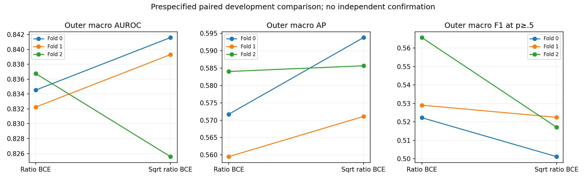
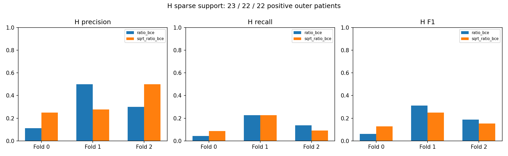
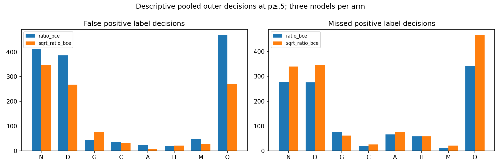

# V11 interpretation and execution closeout

All six prespecified fits completed. The primary rule nominates square-root ratio BCE for future study because its mean outer macro AUROC is numerically higher. This is not evidence of a reliable improvement, a deployment decision or authorization to refit. No single fold checkpoint is selected as a global model.

| Paired mean difference (sqrt − ratio) | Estimate | Conditional 95% interval | Defined / total |
|---|---:|---:|---:|
| macro_auroc | +0.00098 | [-0.00930, +0.01058] | 2000 / 2000 |
| macro_auprc_average_precision | +0.01175 | [-0.00563, +0.02699] | 2000 / 2000 |
| macro_f1 | -0.02541 | [-0.04540, -0.00435] | 2000 / 2000 |

The fixed 2,000-replicate paired containment-component bootstrap uses seed 2026, samples within outer folds and conditions on fitted models. It omits training/checkpoint-selection variability. The AUROC/AP intervals include zero; fixed-threshold macro F1 is lower for the alternative. Fold 2 reverses the AUROC direction. Prior adaptive model/schedule choices, same-source data and one training seed limit independence. These outer results are not directly comparable with old validation/held-out numbers from different fitting cohorts.

## All-eight descriptive pooled decisions

Each of 2,275 training-cohort patients contributes one untouched outer prediction per arm. These counts summarize three separate models per arm; pooled ranking metrics are secondary. All decisions use mean-eye sigmoid probabilities at fixed p≥0.5, without calibration or threshold fitting.

| Class | Positive / negative support | Precision ratio → sqrt | Recall ratio → sqrt | F1 ratio → sqrt | TP ratio → sqrt | FP ratio → sqrt | FN ratio → sqrt |
|---|---:|---:|---:|---:|---:|---:|---:|
| N | 738 / 1537 | 0.5281 → 0.5335 | 0.6247 → 0.5393 | 0.5723 → 0.5364 | 461 → 398 | 412 → 348 | 277 → 340 |
| D | 733 / 1542 | 0.5421 → 0.5908 | 0.6235 → 0.5280 | 0.5799 → 0.5576 | 457 → 387 | 386 → 268 | 276 → 346 |
| G | 140 / 2135 | 0.5833 → 0.5098 | 0.4500 → 0.5571 | 0.5081 → 0.5324 | 63 → 78 | 45 → 75 | 77 → 62 |
| C | 138 / 2137 | 0.7628 → 0.7778 | 0.8623 → 0.8116 | 0.8095 → 0.7943 | 119 → 112 | 37 → 32 | 19 → 26 |
| A | 107 / 2168 | 0.6308 → 0.8000 | 0.3832 → 0.2991 | 0.4767 → 0.4354 | 41 → 32 | 24 → 8 | 66 → 75 |
| H | 67 / 2208 | 0.3103 → 0.3000 | 0.1343 → 0.1343 | 0.1875 → 0.1856 | 9 → 9 | 20 → 21 | 58 → 58 |
| M | 113 / 2162 | 0.6800 → 0.7731 | 0.9027 → 0.8142 | 0.7757 → 0.7931 | 102 → 92 | 48 → 27 | 11 → 21 |
| O | 636 / 1639 | 0.3850 → 0.3855 | 0.4607 → 0.2673 | 0.4195 → 0.3157 | 293 → 170 | 468 → 271 | 343 → 466 |

H has 23/22/22 outer positives (66 positive containment components overall). Both arms detect only 9/67 positives, with 58 missed; square-root weighting has 21 rather than 20 false positives. H foldwise F1 is 0.0625/0.3125/0.1875 for ratio versus 0.1290/0.2500/0.1538 for square-root. Apparent fold-0 improvement does not persist across folds. H recall/F1 paired intervals include zero. No clinical sensitivity target or guarantee is inferred.

Overall, square-root weighting reduces pooled false positives but increases missed positives; G gains recall with more false positives, while O loses substantial recall. These outcomes do not support a broad rare-class improvement claim. Preserve both losses and all unsuccessful/negative findings. Do not deploy exploratory thresholds or transfer the old calibration temperature to these checkpoints.

## Compute, recovery and protected artifacts

Actual settled free GPU-quota use was **4,113.487 seconds (1.142635 hours)** for six actual versioned sessions, versus the strict 14,400-second cap. Separate worker elapsed time was 3,953.290 seconds. Paid scaling remained disabled. One additional pre-session SaveKernel HTTP400 request was recovered only after inventory/version/quota checks established no session or charge. Provider identifier validation is plausible, not proven; only the provider name changed. Failed-request evidence is preserved.

Best/last checkpoints, histories, source/nonce provenance, aligned image/patient predictions and hashes were retrieved from every pinned private Kaggle version. Static embedded-worker decoding matches the approved source hash; fit-only weights, inner-only selection, frozen outer membership and mean-eye aggregation were checked. A fresh independent download demonstrates durable retrieval. No historical final/calibration payload was opened and the original demo bundle hashes remain unchanged. No GPU jobs or monitors continue.

Next: review these results and design a separately approved confirmation plan using a fresh suitable independent labeled cohort, without overlap/copies with earlier cohorts. Paired eyes, authoritative all-eight labels, representative site/device/time sampling and sufficiently precise H assessment are needed. Choose size by clustering-aware precision/power analysis. There is no automatic full-data refit, new calibration, demo replacement or acceptance policy; deployment remains REVIEW REQUIRED.

[Full per-fold report](RESULTS.md) · [Per-class CSV](per-class.csv) · [Paired aggregates/intervals](comparison.json) · [Accounting and artifact hashes](execution-provenance.json)

