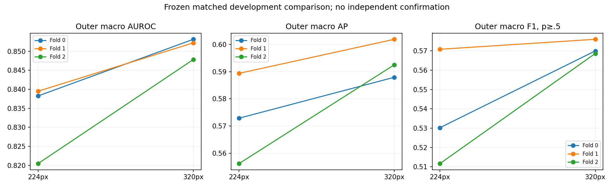
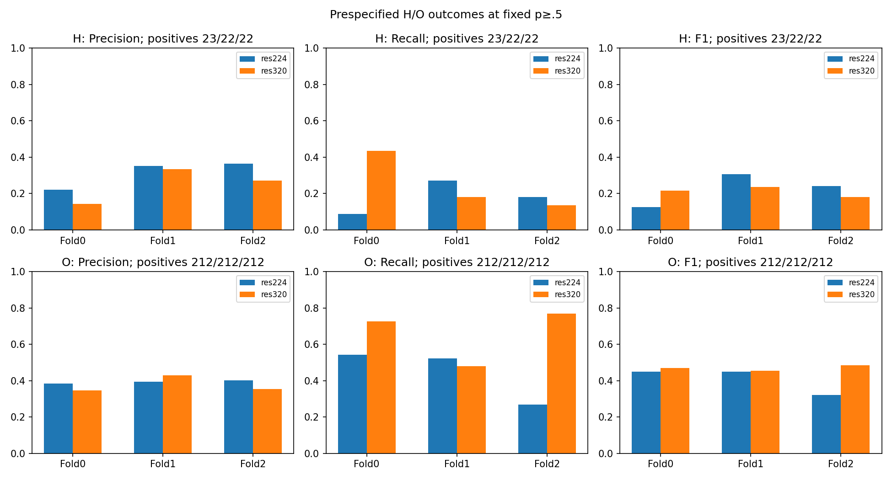
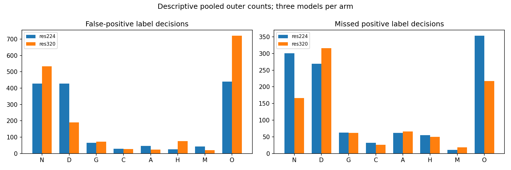

# V13 matched resolution findings

All six fresh-ImageNet ConvNeXt-Tiny ratio-BCE fits completed. The unchanged training-only containment folds, common microbatch8/accumulation2, inner-only checkpoint selection, raw mean-eye sigmoid predictor and fixed p≥.5 define this comparison. V11 checkpoints were not used as references. No historical final, calibration, threshold fitting, full-data refit or demo change.

| Arm | Mean outer macro AUROC | Mean macro AP | Mean macro F1 | Mean micro F1 |
|---|---:|---:|---:|---:|
| res224 | 0.83273 | 0.57279 | 0.53758 | 0.53534 |
| res320 | 0.85108 | 0.59412 | 0.57156 | 0.57509 |

| Paired mean difference (320−224) | Estimate | Conditional 95% interval | Defined / total |
|---|---:|---:|---:|
| macro_auroc | +0.01835 | [+0.01036, +0.02655] | 2000 / 2000 |
| macro_auprc_average_precision | +0.02133 | [+0.00829, +0.03713] | 2000 / 2000 |
| macro_f1 | +0.03398 | [+0.01370, +0.05323] | 2000 / 2000 |
| H_recall | +0.07049 | [-0.01515, +0.15219] | 2000 / 2000 |
| H_f1 | -0.01432 | [-0.09749, +0.06137] | 2000 / 2000 |

The conditional paired primary interval favors320 on this development cohort; this is not independent confirmation. Any macro F1 increase must be considered alongside all-class false-positive/false-negative tradeoffs.
The prespecified numerical rule nominates res320 for future study only. There is no global fold-checkpoint selection, deployment decision or automatic refit.

Intervals use2000 paired component-cluster bootstrap replicates, fixed seed2026, sampling within each outer fold with the same groups for both arms. They condition on fitted models and omit training/checkpoint-selection variability. Previous adaptive choices, same-source data, three folds and one seed limit independence. Outer sample separation inside each fit does not erase prior development exposure.

## Every class: descriptive pooled outer decisions

All2275 training patients contribute once per arm. Each arm pools predictions from three separately trained models; pooled ranking metrics are secondary. See per-class.csv for every fold/arm row and comparison.json for support/undefined flags.

| Class | Arm | Positive / negative | AUROC | AP | Precision | Recall | F1 | TP | FP | FN |
|---|---|---:|---:|---:|---:|---:|---:|---:|---:|---:|
| N | res224 | 738 / 1537 | 0.7213 | 0.5291 | 0.5058 | 0.5921 | 0.5456 | 437 | 427 | 301 |
| N | res320 | 738 / 1537 | 0.7736 | 0.5894 | 0.5176 | 0.7751 | 0.6207 | 572 | 533 | 166 |
| D | res224 | 733 / 1542 | 0.7561 | 0.6225 | 0.5202 | 0.6330 | 0.5711 | 464 | 428 | 269 |
| D | res320 | 733 / 1542 | 0.7936 | 0.6922 | 0.6870 | 0.5689 | 0.6224 | 417 | 190 | 316 |
| G | res224 | 140 / 2135 | 0.9148 | 0.5203 | 0.5385 | 0.5500 | 0.5442 | 77 | 66 | 63 |
| G | res320 | 140 / 2135 | 0.9244 | 0.4735 | 0.5166 | 0.5571 | 0.5361 | 78 | 73 | 62 |
| C | res224 | 138 / 2137 | 0.9790 | 0.8199 | 0.7852 | 0.7681 | 0.7766 | 106 | 29 | 32 |
| C | res320 | 138 / 2137 | 0.9671 | 0.8475 | 0.8000 | 0.8116 | 0.8058 | 112 | 28 | 26 |
| A | res224 | 107 / 2168 | 0.8719 | 0.4585 | 0.4891 | 0.4206 | 0.4523 | 45 | 47 | 62 |
| A | res320 | 107 / 2168 | 0.9059 | 0.5251 | 0.6308 | 0.3832 | 0.4767 | 41 | 24 | 66 |
| H | res224 | 67 / 2208 | 0.7203 | 0.1962 | 0.3243 | 0.1791 | 0.2308 | 12 | 25 | 55 |
| H | res320 | 67 / 2208 | 0.7410 | 0.1775 | 0.1828 | 0.2537 | 0.2125 | 17 | 76 | 50 |
| M | res224 | 113 / 2162 | 0.9865 | 0.8680 | 0.6986 | 0.9027 | 0.7876 | 102 | 44 | 11 |
| M | res320 | 113 / 2162 | 0.9944 | 0.9014 | 0.8246 | 0.8319 | 0.8282 | 94 | 20 | 19 |
| O | res224 | 636 / 1639 | 0.6432 | 0.3975 | 0.3920 | 0.4450 | 0.4168 | 283 | 439 | 353 |
| O | res320 | 636 / 1639 | 0.6518 | 0.4059 | 0.3679 | 0.6588 | 0.4721 | 419 | 720 | 217 |

## H and O tradeoffs

- H: recall 0.1791→0.2537, F1 0.2308→0.2125; TP 12→17, FP 25→76, FN 55→50, among 67 positive patients. These are fixed-threshold development counts, not a clinical sensitivity guarantee.
- O: recall 0.4450→0.6588, F1 0.4168→0.4721; TP 283→419, FP 439→720, FN 353→217, among 636 positive patients. These are fixed-threshold development counts, not a clinical sensitivity guarantee.

H has only23/22/22 outer positives and66 positive containment components overall. Sparse support increases uncertainty but is not a sole explanation for its errors. Patient-derived labels are inherited by both eye targets; H/O case-definition and localization limitations from v12 persist. Resolution changes neither source labels nor clinical validity. Negative findings and class-specific harms must be retained.

## Execution, accounting and recovery

See execution-audit.json for actual versions, source/nonce/output hashes, dependencies and worker times; execution-provenance.json records settled quota counters separately. Best/last checkpoints, aligned eye/patient predictions, histories and logs remain in pinned private Kaggle output versions and private local artifacts, outside Git. The approved scientific worker/configuration/protocol/reporter hashes are unchanged.

Next research decisions need separate authorization and a fresh suitable independent paired-eye/all-eight labeled evaluation cohort with compatible definitions and overlap exclusion. Do not tune on the historical final holdout, transfer its calibration to these checkpoints, deploy exploratory thresholds or replace the working demo. REVIEW REQUIRED remains unchanged.

[Frozen protocol](../../docs/RESOLUTION_V13.md) · [Complete paired aggregates](comparison.json) · [Per-fold per-class CSV](per-class.csv) · [Execution audit](EXECUTION.md)

