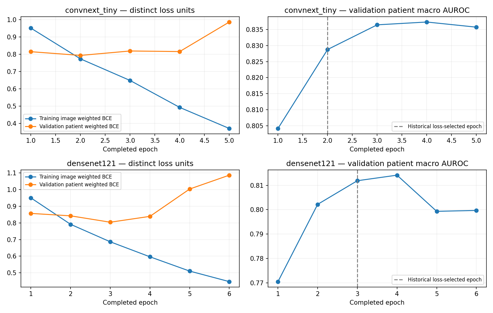

# Second-round development diagnosis

Generated from the checksum-bound audit of existing histories and validation predictions. No fitting or final-evaluation rerun. The historical final aggregate is verified only in a separate private preservation record and is not used here.

## Support and retained partition structure

| Label | Train + / − patients | Validation + / − patients | Validation + / − supplying components |
|---|---:|---:|---:|
| N | 738 / 1537 | 175 / 350 | 174 / 344 |
| D | 733 / 1542 | 169 / 356 | 168 / 352 |
| G | 140 / 2135 | 32 / 493 | 31 / 488 |
| C | 138 / 2137 | 32 / 493 | 32 / 487 |
| A | 107 / 2168 | 25 / 500 | 25 / 493 |
| H | 67 / 2208 | 16 / 509 | 16 / 502 |
| M | 113 / 2162 | 26 / 499 | 26 / 492 |
| O | 636 / 1639 | 147 / 378 | 144 / 376 |

Both eyes remain with their patient; all containment groups retain their existing roles. Validation has 518 components; training has 2,240. Mixed-label groups can supply both outcomes, so supplying counts are not independent-binomial sample sizes. Validation is already development-exposed; H has only 16 positives.

## Observed selection and curves

| Backbone | Historical loss-selected epoch | Selected AUROC | Best recorded AUROC epoch / score | 25-epoch whole-worker extrapolation |
|---|---:|---:|---:|---:|
| convnext_tiny | 2 | 0.82876 | 4 / 0.83733 | 0.752 h |
| densenet121 | 3 | 0.81189 | 4 / 0.81417 | 0.436 h |

Training loss keeps falling as validation loss deteriorates: evidence against assuming that a longer run alone will help. AUROC and weighted loss favor different epochs. The prospective AUROC-selected baseline aligns the selection objective; its comparison with a cosine arm changes only the LR schedule within this round. Historical v5 results are preserved.

Training image BCE and validation mean-eye patient BCE use different units/predictors; absolute gaps must not be interpreted as directly comparable generalization errors. LR was declared constant 1e-4 in the checksum-bound v5 configuration, with no scheduler.

## Per-class validation errors at fixed p ≥ 0.5

| Backbone | Label | + / − | Predicted + | AUROC | AP | Precision | Recall | F1 |
|---|---|---:|---:|---:|---:|---:|---:|
| convnext_tiny | N | 175 / 350 | 237 | 0.7361 | 0.5143 | 0.5063 | 0.6857 | 0.5825 |
| convnext_tiny | D | 169 / 356 | 294 | 0.7308 | 0.5687 | 0.4558 | 0.7929 | 0.5788 |
| convnext_tiny | G | 32 / 493 | 31 | 0.8319 | 0.4134 | 0.4516 | 0.4375 | 0.4444 |
| convnext_tiny | C | 32 / 493 | 78 | 0.9718 | 0.7107 | 0.3846 | 0.9375 | 0.5455 |
| convnext_tiny | A | 25 / 500 | 67 | 0.9516 | 0.6582 | 0.3284 | 0.8800 | 0.4783 |
| convnext_tiny | H | 16 / 509 | 183 | 0.7574 | 0.1196 | 0.0601 | 0.6875 | 0.1106 |
| convnext_tiny | M | 26 / 499 | 58 | 0.9885 | 0.8974 | 0.4138 | 0.9231 | 0.5714 |
| convnext_tiny | O | 147 / 378 | 166 | 0.6620 | 0.4362 | 0.4699 | 0.5306 | 0.4984 |
| densenet121 | N | 175 / 350 | 169 | 0.7169 | 0.5200 | 0.5148 | 0.4971 | 0.5058 |
| densenet121 | D | 169 / 356 | 285 | 0.7009 | 0.5019 | 0.4456 | 0.7515 | 0.5595 |
| densenet121 | G | 32 / 493 | 110 | 0.8665 | 0.3992 | 0.2273 | 0.7812 | 0.3521 |
| densenet121 | C | 32 / 493 | 55 | 0.9814 | 0.7801 | 0.5273 | 0.9062 | 0.6667 |
| densenet121 | A | 25 / 500 | 94 | 0.8528 | 0.4502 | 0.1915 | 0.7200 | 0.3025 |
| densenet121 | H | 16 / 509 | 101 | 0.7542 | 0.1196 | 0.0693 | 0.4375 | 0.1197 |
| densenet121 | M | 26 / 499 | 40 | 0.9809 | 0.8832 | 0.5750 | 0.8846 | 0.6970 |
| densenet121 | O | 147 / 378 | 330 | 0.6415 | 0.3882 | 0.3485 | 0.7823 | 0.4822 |

Unclipped H training positive weight is 32.955; ConvNeXt predicts H positive in 183 validation patients with only 16 positives (11 TP, 172 FP, 5 FN). This motivates a later separate threshold/weighting study, not a claim that annotation labels are wrong or that threshold tuning improves ranking. N/D/O ranking also limits performance. All patient-derived labels remain unchanged.

## Proposed controlled queue

Exactly four new fits: both backbones × constant/cosine LR, 25-epoch maximum, patience six on all-eight validation macro AUROC, seed 2026, ImageNet V1, original 224-pixel preprocessing/weighted BCE and fixed p=0.5. Higher resolution, alternative loss, threshold fitting and calibration are outside this approval.

Linear historical worker-time extrapolation: 2.376 h. Request four GPU-quota hours: max six 30-minute worker sessions plus ten-minute overhead guard per attempt. Failed/ambiguous attempts count; no automatic retries beyond caps. Cold start/accounting can differ from the extrapolation.

These are development comparisons on a repeatedly used cohort, not evidence of new generalization performance. A new suitable independent evaluation cohort and prospective protocol are required. No demo replacement or ACCEPT threshold follows.
