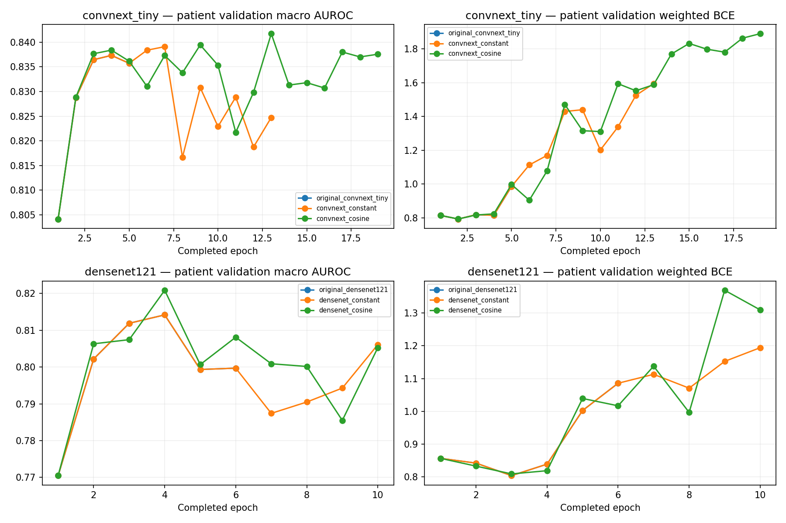

# Controlled second-round validation results

Generated from retrieved checksum/source/nonce-verified prediction files. All comparisons use the same 525 patients, 518 containment components, eight labels and fixed p ≥ 0.5. No historical final or calibration prediction arrays were opened.

All four runs complete; primary selected development run: **convnext_cosine**.

| Run | Epochs / best | Macro AUROC | Macro AP | Macro F1 | Micro F1 | Δ AUROC vs original selected | Δ macro F1 |
|---|---:|---:|---:|---:|---:|---:|---:|
| original_convnext_tiny | 5 / 2 | 0.82876 | 0.53982 | 0.47624 | 0.49885 | +0.00000 | +0.00000 |
| original_densenet121 | 6 / 3 | 0.81189 | 0.50530 | 0.46067 | 0.47730 | -0.01688 | -0.01556 |
| convnext_constant | 13 / 7 | 0.83909 | 0.60181 | 0.55575 | 0.54545 | +0.01033 | +0.07952 |
| convnext_cosine | 19 / 13 | 0.84173 | 0.61131 | 0.59263 | 0.57143 | +0.01296 | +0.11640 |
| densenet_constant | 10 / 4 | 0.81417 | 0.49054 | 0.48999 | 0.50265 | -0.01459 | +0.01375 |
| densenet_cosine | 10 / 4 | 0.82086 | 0.48588 | 0.47812 | 0.50031 | -0.00791 | +0.00189 |

Checkpoint/backbone selection is macro AUROC, not F1. The old v5 checkpoints were selected by validation loss. Thus v9-versus-v5 comparisons also change checkpoint/early-stop rules and training budget; only the within-v9 same-backbone constant/cosine contrast changes the LR schedule alone.

## All-eight false positives and F1

| Run | Label | Positive / negative | TP | FP | FN | Precision | Recall | F1 | Δ FP vs original selected | Δ F1 |
|---|---|---:|---:|---:|---:|---:|---:|---:|---:|---:|
| original_convnext_tiny | N | 175 / 350 | 120 | 117 | 55 | 0.5063 | 0.6857 | 0.5825 | +0 | +0.0000 |
| original_convnext_tiny | D | 169 / 356 | 134 | 160 | 35 | 0.4558 | 0.7929 | 0.5788 | +0 | +0.0000 |
| original_convnext_tiny | G | 32 / 493 | 14 | 17 | 18 | 0.4516 | 0.4375 | 0.4444 | +0 | +0.0000 |
| original_convnext_tiny | C | 32 / 493 | 30 | 48 | 2 | 0.3846 | 0.9375 | 0.5455 | +0 | +0.0000 |
| original_convnext_tiny | A | 25 / 500 | 22 | 45 | 3 | 0.3284 | 0.8800 | 0.4783 | +0 | +0.0000 |
| original_convnext_tiny | H | 16 / 509 | 11 | 172 | 5 | 0.0601 | 0.6875 | 0.1106 | +0 | +0.0000 |
| original_convnext_tiny | M | 26 / 499 | 24 | 34 | 2 | 0.4138 | 0.9231 | 0.5714 | +0 | +0.0000 |
| original_convnext_tiny | O | 147 / 378 | 78 | 88 | 69 | 0.4699 | 0.5306 | 0.4984 | +0 | +0.0000 |
| original_densenet121 | N | 175 / 350 | 87 | 82 | 88 | 0.5148 | 0.4971 | 0.5058 | -35 | -0.0767 |
| original_densenet121 | D | 169 / 356 | 127 | 158 | 42 | 0.4456 | 0.7515 | 0.5595 | -2 | -0.0194 |
| original_densenet121 | G | 32 / 493 | 25 | 85 | 7 | 0.2273 | 0.7812 | 0.3521 | +68 | -0.0923 |
| original_densenet121 | C | 32 / 493 | 29 | 26 | 3 | 0.5273 | 0.9062 | 0.6667 | -22 | +0.1212 |
| original_densenet121 | A | 25 / 500 | 18 | 76 | 7 | 0.1915 | 0.7200 | 0.3025 | +31 | -0.1757 |
| original_densenet121 | H | 16 / 509 | 7 | 94 | 9 | 0.0693 | 0.4375 | 0.1197 | -78 | +0.0091 |
| original_densenet121 | M | 26 / 499 | 23 | 17 | 3 | 0.5750 | 0.8846 | 0.6970 | -17 | +0.1255 |
| original_densenet121 | O | 147 / 378 | 115 | 215 | 32 | 0.3485 | 0.7823 | 0.4822 | +127 | -0.0162 |
| convnext_constant | N | 175 / 350 | 109 | 96 | 66 | 0.5317 | 0.6229 | 0.5737 | -21 | -0.0088 |
| convnext_constant | D | 169 / 356 | 91 | 72 | 78 | 0.5583 | 0.5385 | 0.5482 | -88 | -0.0306 |
| convnext_constant | G | 32 / 493 | 14 | 13 | 18 | 0.5185 | 0.4375 | 0.4746 | -4 | +0.0301 |
| convnext_constant | C | 32 / 493 | 22 | 6 | 10 | 0.7857 | 0.6875 | 0.7333 | -42 | +0.1879 |
| convnext_constant | A | 25 / 500 | 11 | 4 | 14 | 0.7333 | 0.4400 | 0.5500 | -41 | +0.0717 |
| convnext_constant | H | 16 / 509 | 4 | 11 | 12 | 0.2667 | 0.2500 | 0.2581 | -161 | +0.1475 |
| convnext_constant | M | 26 / 499 | 24 | 7 | 2 | 0.7742 | 0.9231 | 0.8421 | -27 | +0.2707 |
| convnext_constant | O | 147 / 378 | 79 | 113 | 68 | 0.4115 | 0.5374 | 0.4661 | +25 | -0.0323 |
| convnext_cosine | N | 175 / 350 | 94 | 71 | 81 | 0.5697 | 0.5371 | 0.5529 | -46 | -0.0296 |
| convnext_cosine | D | 169 / 356 | 102 | 85 | 67 | 0.5455 | 0.6036 | 0.5730 | -75 | -0.0058 |
| convnext_cosine | G | 32 / 493 | 15 | 8 | 17 | 0.6522 | 0.4688 | 0.5455 | -9 | +0.1010 |
| convnext_cosine | C | 32 / 493 | 24 | 6 | 8 | 0.8000 | 0.7500 | 0.7742 | -42 | +0.2287 |
| convnext_cosine | A | 25 / 500 | 16 | 7 | 9 | 0.6957 | 0.6400 | 0.6667 | -38 | +0.1884 |
| convnext_cosine | H | 16 / 509 | 3 | 1 | 13 | 0.7500 | 0.1875 | 0.3000 | -171 | +0.1894 |
| convnext_cosine | M | 26 / 499 | 20 | 3 | 6 | 0.8696 | 0.7692 | 0.8163 | -31 | +0.2449 |
| convnext_cosine | O | 147 / 378 | 72 | 62 | 75 | 0.5373 | 0.4898 | 0.5125 | -26 | +0.0141 |
| densenet_constant | N | 175 / 350 | 121 | 120 | 54 | 0.5021 | 0.6914 | 0.5817 | +3 | -0.0008 |
| densenet_constant | D | 169 / 356 | 108 | 136 | 61 | 0.4426 | 0.6391 | 0.5230 | -24 | -0.0558 |
| densenet_constant | G | 32 / 493 | 23 | 61 | 9 | 0.2738 | 0.7188 | 0.3966 | +44 | -0.0479 |
| densenet_constant | C | 32 / 493 | 30 | 26 | 2 | 0.5357 | 0.9375 | 0.6818 | -22 | +0.1364 |
| densenet_constant | A | 25 / 500 | 17 | 93 | 8 | 0.1545 | 0.6800 | 0.2519 | +48 | -0.2264 |
| densenet_constant | H | 16 / 509 | 8 | 37 | 8 | 0.1778 | 0.5000 | 0.2623 | -135 | +0.1517 |
| densenet_constant | M | 26 / 499 | 24 | 14 | 2 | 0.6316 | 0.9231 | 0.7500 | -20 | +0.1786 |
| densenet_constant | O | 147 / 378 | 95 | 160 | 52 | 0.3725 | 0.6463 | 0.4726 | +72 | -0.0258 |
| densenet_cosine | N | 175 / 350 | 129 | 149 | 46 | 0.4640 | 0.7371 | 0.5695 | +32 | -0.0130 |
| densenet_cosine | D | 169 / 356 | 107 | 127 | 62 | 0.4573 | 0.6331 | 0.5310 | -33 | -0.0478 |
| densenet_cosine | G | 32 / 493 | 19 | 55 | 13 | 0.2568 | 0.5938 | 0.3585 | +38 | -0.0860 |
| densenet_cosine | C | 32 / 493 | 29 | 25 | 3 | 0.5370 | 0.9062 | 0.6744 | -23 | +0.1290 |
| densenet_cosine | A | 25 / 500 | 15 | 61 | 10 | 0.1974 | 0.6000 | 0.2970 | +16 | -0.1812 |
| densenet_cosine | H | 16 / 509 | 7 | 35 | 9 | 0.1667 | 0.4375 | 0.2414 | -137 | +0.1308 |
| densenet_cosine | M | 26 / 499 | 21 | 12 | 5 | 0.6364 | 0.8077 | 0.7119 | -22 | +0.1404 |
| densenet_cosine | O | 147 / 378 | 77 | 125 | 70 | 0.3812 | 0.5238 | 0.4413 | +37 | -0.0571 |

[Full permitted metrics/provenance](verified-comparison.json) · [Comparison CSV](validation-comparison.csv) · [Per-class FP/FN/F1 CSV](per-class-false-positives-f1.csv)

## Accuracy definitions and limitations

Exact match requires all eight labels correct. Labelwise binary accuracy averages correct label bits; it is not diagnostic accuracy. Hamming loss is its complement. Macro F1 averages eight F1 values; micro F1 uses pooled TP/FP/FN on the (n,8) matrix. Rare support and undefined-denominator conventions remain visible in the artifacts.

- Reused development cohort; checkpoint/backbone selection optimism
- One training seed; no estimate of seed variance
- Rare H has 16 validation positives
- Labels are patient-derived, not independently verified eye-specific diagnoses
- V9 vs v5 also changes checkpoint/early-stop/budget rules; schedule-only contrast is within each v9 pair
- New independent suitable evaluation cohort required for a new performance claim
- All patients remain REVIEW REQUIRED

No result changes the model, thresholds, calibration, splits or pipeline after seeing this development comparison. No demo promotion or automatic ACCEPT policy occurs.

## Observed metric tradeoffs

- convnext_constant: Δ macro AUROC +0.01033, Δ macro F1 +0.07952; higher FP counts in O; lower F1 in N, D, O. Deltas refer to the original selected ConvNeXt; same-backbone deltas are also retained in the CSV. These are reused-validation findings, not independent performance claims.
- convnext_cosine: Δ macro AUROC +0.01296, Δ macro F1 +0.11640; higher FP counts in no labels; lower F1 in N, D. Deltas refer to the original selected ConvNeXt; same-backbone deltas are also retained in the CSV. These are reused-validation findings, not independent performance claims.
- densenet_constant: Δ macro AUROC -0.01459, Δ macro F1 +0.01375; higher FP counts in N, G, A, O; lower F1 in N, D, G, A, O. Deltas refer to the original selected ConvNeXt; same-backbone deltas are also retained in the CSV. These are reused-validation findings, not independent performance claims.
- densenet_cosine: Δ macro AUROC -0.00791, Δ macro F1 +0.00189; higher FP counts in N, G, A, O; lower F1 in N, D, G, A, O. Deltas refer to the original selected ConvNeXt; same-backbone deltas are also retained in the CSV. These are reused-validation findings, not independent performance claims.
