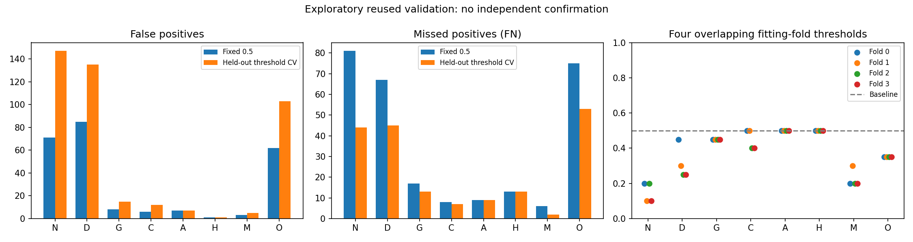

# Exploratory group-aware threshold analysis v10

CPU-only; generated from verified saved development predictions. The selected ConvNeXt cosine epoch-13 model is fixed. All 525 patients / 518 containment components are reused; no historical final or calibration datasets were opened. No old temperature was applied, model inference performed, or demo replaced.

[Prospective protocol](../../docs/THRESHOLD_V10.md) and configuration were committed at `1d1516f1f1687b2b49a4962287b04b8a1b36ce2e` before computing this analysis. Four fixed seed-2026 multilabel containment-group folds use the existing rarest-label allocator. Each threshold is fitted on three folds and assessed on its untouched threshold-assessment fold. Objective: per-class F1 on .05:.05:.95; exact ties nearest .5, then higher; fewer than 10 supplying fitting components for either outcome retains .5. Predictions use p ≥ threshold and patient weights.

**These are not independent model-assessment folds.** All validation labels already influenced checkpoint/backbone selection. Cross-validation protects the threshold-fitting step only; it cannot remove prior model-selection bias. This remains exploratory and provides no independent confirmation.

| Procedure | Macro F1 | Micro F1 | TP | FP | FN | Exact match | Labelwise accuracy |
|---|---:|---:|---:|---:|---:|---:|---:|
| Fixed 0.5 | 0.5926 | 0.5714 | 346 | 243 | 276 | 0.4152 | 0.8764 |
| Pooled held-out threshold CV | 0.6055 | 0.5880 | 436 | 425 | 186 | 0.2952 | 0.8545 |

Exact match requires all eight labels correct; labelwise accuracy averages correct bits and is not diagnostic accuracy. Macro F1 averages eight F1s; micro F1 pools TP/FP/FN on (n,8) arrays. Zero-denominator metrics use zero with defined flags retained in the aggregate/CSV.

## Per-class held-out outcomes

| Class | + / − | Procedure | Precision | Recall | F1 | TP | FP | FN |
|---|---:|---|---:|---:|---:|---:|---:|---:|
| N | 175 / 350 | fixed_0.5 | 0.5697 | 0.5371 | 0.5529 | 94 | 71 | 81 |
| N | 175 / 350 | heldout_threshold_cv | 0.4712 | 0.7486 | 0.5784 | 131 | 147 | 44 |
| D | 169 / 356 | fixed_0.5 | 0.5455 | 0.6036 | 0.5730 | 102 | 85 | 67 |
| D | 169 / 356 | heldout_threshold_cv | 0.4788 | 0.7337 | 0.5794 | 124 | 135 | 45 |
| G | 32 / 493 | fixed_0.5 | 0.6522 | 0.4688 | 0.5455 | 15 | 8 | 17 |
| G | 32 / 493 | heldout_threshold_cv | 0.5588 | 0.5938 | 0.5758 | 19 | 15 | 13 |
| C | 32 / 493 | fixed_0.5 | 0.8000 | 0.7500 | 0.7742 | 24 | 6 | 8 |
| C | 32 / 493 | heldout_threshold_cv | 0.6757 | 0.7812 | 0.7246 | 25 | 12 | 7 |
| A | 25 / 500 | fixed_0.5 | 0.6957 | 0.6400 | 0.6667 | 16 | 7 | 9 |
| A | 25 / 500 | heldout_threshold_cv | 0.6957 | 0.6400 | 0.6667 | 16 | 7 | 9 |
| H | 16 / 509 | fixed_0.5 | 0.7500 | 0.1875 | 0.3000 | 3 | 1 | 13 |
| H | 16 / 509 | heldout_threshold_cv | 0.7500 | 0.1875 | 0.3000 | 3 | 1 | 13 |
| M | 26 / 499 | fixed_0.5 | 0.8696 | 0.7692 | 0.8163 | 20 | 3 | 6 |
| M | 26 / 499 | heldout_threshold_cv | 0.8276 | 0.9231 | 0.8727 | 24 | 5 | 2 |
| O | 147 / 378 | fixed_0.5 | 0.5373 | 0.4898 | 0.5125 | 72 | 62 | 75 |
| O | 147 / 378 | heldout_threshold_cv | 0.4772 | 0.6395 | 0.5465 | 94 | 103 | 53 |

## Threshold stability

| Class | Folds 0 / 1 / 2 / 3 | Min–max | Median | Q1–Q3 | IQR | Fallback fits |
|---|---|---|---:|---|---:|---:|
| N | 0.20 / 0.10 / 0.20 / 0.10 | 0.10–0.20 | 0.150 | 0.100–0.200 | 0.100 | 0 |
| D | 0.45 / 0.30 / 0.25 / 0.25 | 0.25–0.45 | 0.275 | 0.250–0.338 | 0.088 | 0 |
| G | 0.45 / 0.45 / 0.45 / 0.45 | 0.45–0.45 | 0.450 | 0.450–0.450 | 0.000 | 0 |
| C | 0.50 / 0.50 / 0.40 / 0.40 | 0.40–0.50 | 0.450 | 0.400–0.500 | 0.100 | 0 |
| A | 0.50 / 0.50 / 0.50 / 0.50 | 0.50–0.50 | 0.500 | 0.500–0.500 | 0.000 | 0 |
| H | 0.50 / 0.50 / 0.50 / 0.50 | 0.50–0.50 | 0.500 | 0.500–0.500 | 0.000 | 0 |
| M | 0.20 / 0.30 / 0.20 / 0.20 | 0.20–0.30 | 0.200 | 0.200–0.225 | 0.025 | 0 |
| O | 0.35 / 0.35 / 0.35 / 0.35 | 0.35–0.35 | 0.350 | 0.350–0.350 | 0.000 | 0 |

The four fits overlap; their ranges/IQR describe sensitivity to fitting rows, not confidence intervals or four independent replications. These fold-specific thresholds are not a deployable all-data vector. No all-development refit was performed.

## H: sparse-support examination

| Fold | Fit + / − groups | Threshold | Fallback | Held-out + / − | Baseline TP / FP / FN | CV TP / FP / FN | CV precision / recall / F1 |
|---|---|---:|---|---|---|---|---|
| 0 | 12 / 376 | 0.50 | False | 4 / 128 | 1 / 0 / 3 | 1 / 0 / 3 | 1.000 / 0.250 / 0.400 |
| 1 | 12 / 376 | 0.50 | False | 4 / 127 | 0 / 1 / 4 | 0 / 1 / 4 | 0.000 / 0.000 / 0.000 |
| 2 | 12 / 378 | 0.50 | False | 4 / 127 | 1 / 0 / 3 | 1 / 0 / 3 | 1.000 / 0.250 / 0.400 |
| 3 | 12 / 376 | 0.50 | False | 4 / 127 | 1 / 0 / 3 | 1 / 0 / 3 | 1.000 / 0.250 / 0.400 |

Only 16 H-positive patients exist overall. One changed prediction can substantially move per-fold recall. No clinical recall target, safety claim or acceptance threshold follows from F1 optimization.

## Observed tradeoffs

- N: ΔFP +76, ΔFN -37, ΔTP +37, ΔF1 +0.0254 versus .5. Positive ΔFN means more missed positives; negative ΔFN means fewer. Positive ΔFP means more false alarms.
- D: ΔFP +50, ΔFN -22, ΔTP +22, ΔF1 +0.0064 versus .5. Positive ΔFN means more missed positives; negative ΔFN means fewer. Positive ΔFP means more false alarms.
- G: ΔFP +7, ΔFN -4, ΔTP +4, ΔF1 +0.0303 versus .5. Positive ΔFN means more missed positives; negative ΔFN means fewer. Positive ΔFP means more false alarms.
- C: ΔFP +6, ΔFN -1, ΔTP +1, ΔF1 -0.0496 versus .5. Positive ΔFN means more missed positives; negative ΔFN means fewer. Positive ΔFP means more false alarms.
- A: ΔFP +0, ΔFN +0, ΔTP +0, ΔF1 +0.0000 versus .5. Positive ΔFN means more missed positives; negative ΔFN means fewer. Positive ΔFP means more false alarms.
- H: ΔFP +0, ΔFN +0, ΔTP +0, ΔF1 +0.0000 versus .5. Positive ΔFN means more missed positives; negative ΔFN means fewer. Positive ΔFP means more false alarms.
- M: ΔFP +2, ΔFN -4, ΔTP +4, ΔF1 +0.0564 versus .5. Positive ΔFN means more missed positives; negative ΔFN means fewer. Positive ΔFP means more false alarms.
- O: ΔFP +41, ΔFN -22, ΔTP +22, ΔF1 +0.0341 versus .5. Positive ΔFN means more missed positives; negative ΔFN means fewer. Positive ΔFP means more false alarms.

## Recommendation and limitations

Retain the original frozen research demo and REVIEW REQUIRED behavior. Do not install these exploratory fold thresholds. Use the class-specific count/stability findings to document costs and sparse support, not to invent a clinical recall target. Before deploying a new checkpoint, prospectively define the threshold objective with domain stakeholders and obtain model-development predictions independent of checkpoint selection (for example training-only group-aware out-of-fold model predictions in a separately authorized study), then freeze the complete new pipeline for evaluation on a fresh suitable independent cohort. Probability calibration, if later authorized for the new checkpoint, needs a separate prospective fit; the old temperature is incompatible. No further experiment or data collection is launched here.

Patient-derived labels are not independently verified eye diagnoses. Label-stratified fold assignment uses labels but never model scores. AUROC/AP are unchanged because probability rankings are unchanged. Fold support and raw fold-level outcomes, including negative results, are in [aggregate.json](aggregate.json); [per-class CSV](per-class.csv) contains all counts and defined flags. Private sample-aligned assignments/OOF decisions and their hashes are recorded in the provenance. No final-holdout access, calibration fit, automatic acceptance policy, model training, GPU job or paid resource was used.
